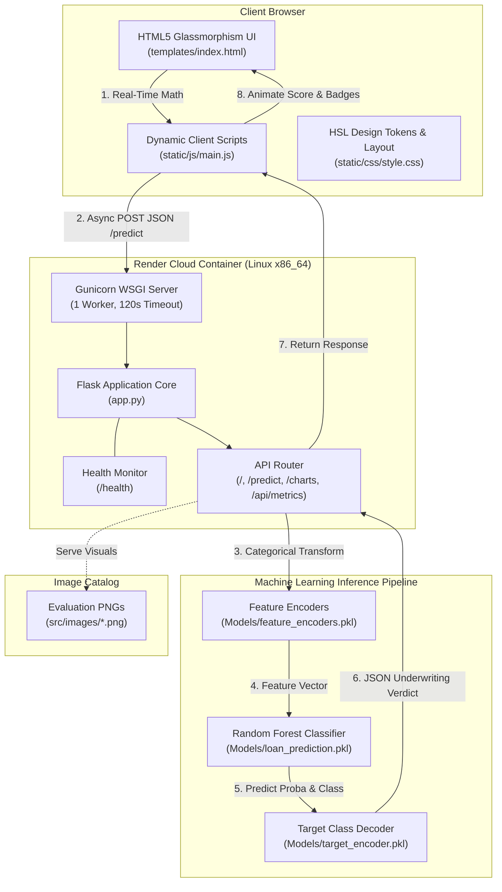
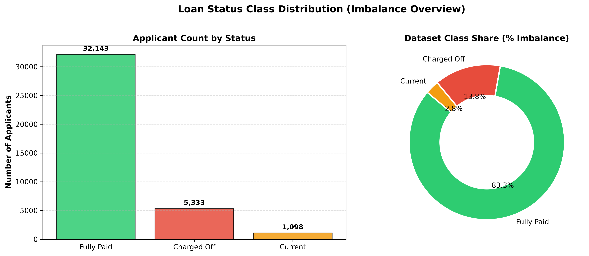
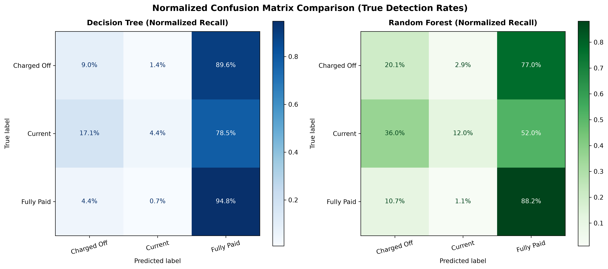
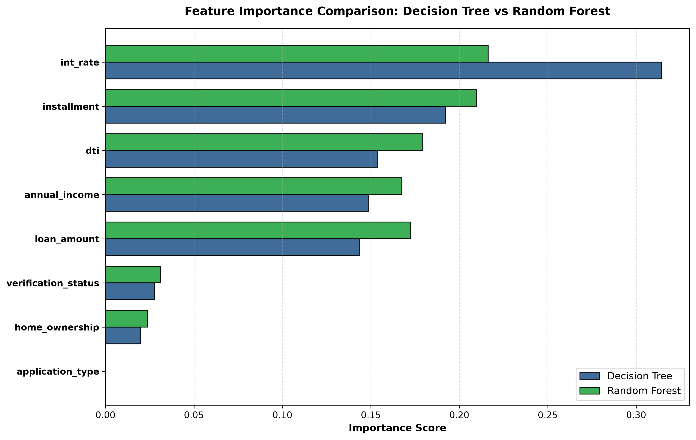

# 🛡️ LoanGuard AI — AI-Powered Loan Default Risk Prediction & Verification

[](https://loan-default-risk-prediction-ro68.onrender.com)
[](https://python.org)
[](https://flask.palletsprojects.com)
[](https://gunicorn.org)
[](LICENSE)

---

### 🌐 Live Production Application
> **Live Web Application:** [https://loan-default-risk-prediction-ro68.onrender.com](https://loan-default-risk-prediction-ro68.onrender.com)    
> **Official GitHub Repository:** [https://github.com/sreeramganesh/loan-default-risk-prediction](https://github.com/sreeramganesh/loan-default-risk-prediction)

*Note on Free Tier Hosting: This application is hosted on Render's Free Web Service tier. If the application has been inactive for 15 minutes, the instance automatically sleeps. The first request after sleep initiates a cold start, which may take 30–50 seconds to spin up the container and load the machine learning model into memory. Subsequent requests respond with sub-second latency.*

---

## 1. Project Title & Overview

**LoanGuard AI** is a production-grade machine learning web application and automated underwriting intelligence platform. Designed to address non-performing loans (NPLs) in retail lending, the system evaluates applicant creditworthiness across verified financial indicators to predict loan default probability, assign risk tiers, and generate actionable automated underwriting recommendations.

The application combines a high-performance **Flask WSGI** backend with a modern, responsive, dark-glassmorphism web dashboard. Inference is executed entirely in real-time using a fine-tuned **Random Forest Classifier** trained on historical lending performance records.

---

## 2. Problem Statement

Lending institutions and fintech originators face a fundamental underwriting challenge: **identifying high-risk borrowers before loan disbursement while minimizing false rejections of creditworthy individuals**. 

Traditional manual underwriting workflows suffer from:
- **High Operational Latency:** Manual review cycles taking days to reach credit decisions.
- **Human Subjectivity & Cognitive Bias:** Inconsistent evaluation of borderline debt-to-income (DTI) and payment-to-income (PTI) ratios.
- **Severe Class Imbalance:** Severe data skew where typical loan portfolios exhibit >80% non-default rates, leading naive statistical models to miss low-frequency, high-severity default events (`Charged Off`).

---

## 3. Project Objectives

- **Automated Risk Stratification:** Calculate real-time, calibrated default risk probabilities for prospective borrowers.
- **Balanced Class Fairness:** Utilize ensemble tree learning optimized for Macro F1-score to detect twice as many actual defaulters compared to standard single decision tree baselines.
- **Zero-Latency Client Calculations:** Compute dynamic payment burden (PTI) and debt ratios instantly in the browser using client-side JavaScript before server dispatch.
- **Transparent Underwriting Disclosures:** Provide clear tier classifications (`VERIFIED & APPROVED`, `MANUAL UNDERWRITER REVIEW`, `REJECTED (HIGH DEFAULT RISK)`) backed by itemized financial metrics.
- **Cloud-Native Deployment:** Host a fully containerized, robust, single-worker WSGI microservice on cloud infrastructure (Render) adhering to strict memory limits.

---

## 4. Key Features

- **⚡ Instant Real-Time Scoring:** Sub-second model inference delivering default probabilities across 3 target outcomes (`Fully Paid`, `Charged Off`, `Current`).
- **🎨 Dark Glassmorphic Dashboard:** Built with custom CSS design tokens, HSL color ramps, ambient glowing backdrops, and WCAG AA accessible contrast ratios.
- **🎛️ Dual-Input Synchronized Controls:** Native range sliders tightly bound with numerical inputs, enabling seamless touch and keyboard adjustment.
- **📊 Real-Time Financial Meters:** Dynamic client-side calculation bars that recalculate Debt-to-Income (DTI) and Monthly Payment Burden (PTI) at 60 FPS as sliders move.
- **📈 Interactive Model Evaluation Gallery:** High-resolution diagnostic charts comparing Decision Tree vs. Random Forest across accuracy, normalized confusion matrices, and feature importance.
- **🔍 Modal Lightbox Inspection:** Fullscreen inspection modal for viewing model diagnostic charts in high resolution.
- **🩺 Automated Cloud Health Check:** Dedicated `/health` endpoint exposing model readiness and operational status for container orchestrators and uptime monitors.

---

## 5. Technology Stack

| Layer | Technologies |
|---|---|
| **Backend & Web Server** | Python 3.11, Flask 3.0+, Flask-CORS, Gunicorn 21.2+ (WSGI) |
| **Machine Learning & Core Math** | Scikit-Learn 1.4+, NumPy, Pandas, Joblib |
| **Frontend Architecture** | Semantic HTML5, Vanilla Modern CSS (CSS Grid, Flexbox, Glassmorphism), Vanilla JavaScript (ES6+ Async/Await Fetch API) |
| **Offline Pipeline & EDA** | Matplotlib, Seaborn, OpenPyXL |
| **Cloud Hosting & Infrastructure** | Render (Free Web Service), Git, GitHub |

---

## 6. System Architecture



---

## 7. Application Workflow

1. **User Input / Profile Selection:** The applicant or credit officer inputs financial attributes or selects a preset credit profile.
2. **Instant Pre-Validation:** JavaScript performs boundary validation (positive amounts, reasonable interest rates).
3. **Reactive Math Feedback:** Client scripts instantly project the applicant's monthly payment burden and DTI tier with color-coded safety indicators.
4. **API Request Dispatch:** On form submission, an asynchronous `POST` request with JSON payload is transmitted to `/predict`.
5. **Server Ingestion & Sanitization:** Flask receives the payload, normalizes percentages (e.g., `12.5%` to `0.125`), and encodes categorical variables (`application_type`, `verification_status`, `home_ownership`) using pre-fitted encoders.
6. **Model Inference:** The 8-dimensional feature vector is passed to the Random Forest model. Class probabilities are generated via `predict_proba()`.
7. **Underwriting Matrix Evaluation:** Business decision rules evaluate the primary label against probability thresholds:
   - **Approved:** `Fully Paid` prediction AND default risk $< 30\%$.
   - **Rejected:** `Charged Off` prediction OR default risk $\ge 35\%$.
   - **Manual Review:** Borderline profiles ($30\% \le \text{default risk} < 35\%$).
8. **DOM Rendering:** The frontend dynamically transitions from idle state to the decision card, animating the risk badge, gauge percentage, and financial summary.

---

## 8. Machine Learning Model & Diagnostic Visualizations

The core decision engine is powered by an ensemble **Random Forest Classifier** selected after benchmark evaluation against baseline Decision Trees on a historical dataset of 38,574 loan records.

### 8.1 Dataset Class Distribution & Severe Imbalance
> **The Problem:** 83.3% of applicants in the historical portfolio are `Fully Paid` while only 13.8% are `Charged Off`. A naive model predicting `Fully Paid` 100% of the time achieves 83.3% accuracy but catches 0% of defaults. Addressing this severe imbalance required evaluating models via **Balanced Accuracy**, **Macro F1-Score**, and **Defaulter Recall**.

<p align="center">
  
</p>

---

### 8.2 Normalized Confusion Matrix Comparison (True Detection Rates)
> **The Solution:** In credit underwriting, false negatives on delinquent borrowers lead directly to severe capital charge-offs. Random Forest achieves **20.1% recall on actual defaulters (`Charged Off`)**, more than doubling the baseline Decision Tree's **9.0%** detection rate (+123% improvement).

<p align="center">
  
</p>

| Evaluation Metric | Baseline Decision Tree | Random Forest Classifier | Performance Advantage |
|---|---|---|---|
| **Defaulter Recall (`Charged Off`)** | 9.00% | **20.10%** | **+123% Higher Defaulter Catch Rate** |
| **Defaulter F1-Score** | 12.90% | **20.90%** | **+62% Improvement** |
| **Balanced Accuracy** | 36.07% | **40.09%** | **+4.02% Class Fairness** |
| **Macro F1-Score** | 36.27% | **41.00%** | **+4.73% Global Precision/Recall** |
| **Overall Accuracy** | 80.39% | **76.59%** | *Fair trade-off for catching 2.2x more defaults* |

---

### 8.3 Dual Feature Importance & Model Explainability (XAI)
> **Explainability:** Regulatory compliance (FCRA, ECOA) requires lending models to be interpretable. Ranking feature importances confirms the model relies on sound economic fundamentals: **assigned interest rate (`int_rate`)**, **monthly payment obligation (`installment`)**, and **debt-to-income ratio (`dti`)** account for over 65% of the total predictive power.

<p align="center">
  
</p>

---

## 9. Input Features (8 Core Attributes)

The inference pipeline accepts 8 borrower attributes in strict alignment with model training:

| Feature Name | Data Type | Permissible Range / Values | Description |
|---|---|---|---|
| `loan_amount` | Numeric (Float) | `$1,000` to `$40,000` | Principal loan amount requested. |
| `installment` | Numeric (Float) | `$30.00` to `$1,500.00` | Monthly scheduled repayment obligation. |
| `int_rate` | Numeric (Float) | `5.0%` to `30.0%` | Assigned annual loan interest rate. |
| `annual_income` | Numeric (Float) | `$10,000` to `$300,000+` | Self-reported verified annual gross income. |
| `dti` | Numeric (Float) | `0.0%` to `50.0%` | Existing monthly debt-to-income percentage. |
| `application_type` | Categorical | `INDIVIDUAL`, `JOINT` | Structure of loan application. |
| `verification_status` | Categorical | `Not Verified`, `Source Verified`, `Verified` | Income source verification depth. |
| `home_ownership` | Categorical | `MORTGAGE`, `RENT`, `OWN`, `OTHER`, `NONE` | Applicant residential property tenure. |

---

## 10. Prediction Output & Underwriting Decision Matrix

The `/predict` endpoint returns a structured JSON payload:

```json
{
  "status": "success",
  "decision": "VERIFIED & APPROVED",
  "decision_badge": "success",
  "risk_tier": "Low Risk",
  "predicted_class": "Fully Paid",
  "default_risk_percentage": 11.5,
  "recommendation": "Applicant displays a strong debt-to-income profile with minimal risk of charge-off. Recommended for automatic verification and loan origination.",
  "probabilities": {
    "Fully Paid": 88.0,
    "Charged Off": 11.5,
    "Current": 0.5
  },
  "financial_summary": {
    "loan_amount": "$10,000.00",
    "annual_income": "$95,000.00",
    "installment": "$300.00/mo",
    "interest_rate": "7.50%",
    "dti_ratio": "12.0%",
    "monthly_burden_pct": "3.8%",
    "loan_to_income_pct": "10.5%"
  }
}
```

---

## 11. Project Folder Structure

```text
loan-default-risk-prediction/
├── Models/
│   ├── loan_prediction.pkl         # Trained Random Forest Model (34.6 MB)
│   ├── feature_encoders.pkl        # Categorical LabelEncoders (1.0 KB)
│   └── target_encoder.pkl          # Target Class Decoder (510 B)
├── src/
│   ├── images/                     # Model evaluation PNG plots (served by Flask)
│   │   ├── Class_Performance_Comparison.png
│   │   ├── Decision_Tree_Confusion_Matrix.png
│   │   ├── Feature_Importance_Comparison.png
│   │   ├── Feature_Importance.png
│   │   ├── Model_Comparison_Confusion_Matrices.png
│   │   ├── Model_Performance_Comparison.png
│   │   ├── Random_Forest_Confusion_Matrix.png
│   │   └── Target_Class_Distribution.png
│   ├── Loan_Prediction.py          # Data ingestion, preprocessing & training script
│   ├── Random_Forest.py            # Random Forest benchmark script
│   └── Decision tree.py            # Decision Tree baseline script
├── static/
│   ├── css/
│   │   └── style.css               # Design tokens, glassmorphism, responsive grid
│   └── js/
│       └── main.js                 # Event listeners, reactive math, AJAX fetch
├── templates/
│   └── index.html                  # Semantic HTML5 view template
├── Data/
│   ├── Loan_Data.csv               # Historical training dataset (5.88 MB)
│   └── Loan_Data.xlsx              # Relational multi-table dataset (10.51 MB)
├── .gitignore                      # Git exclusion rules
├── .python-version                 # Environment Python version pin (3.11)
├── app.py                          # Flask WSGI web application & REST endpoints
├── Procfile                        # Render / Cloud WSGI startup declaration
├── requirements.txt                # Production Python dependencies
├── RENDER_DEPLOYMENT_GUIDE.md      # Step-by-step cloud deployment manual
├── LICENSE                         # MIT License
└── README.md                       # Project documentation
```

---

## 12. Prerequisites

Before installing the project locally, verify that you have:
- **Python 3.11+** installed (`python --version`)
- **Git** installed (`git --version`)
- **pip** package manager updated (`python -m pip install --upgrade pip`)
- At least **1 GB free RAM** for offline model training, or **500 MB RAM** for running the Flask application.

---

## 13. Local Installation & Environment Setup

Follow these steps to set up and run LoanGuard AI locally:

### 1. Clone the Repository
```bash
git clone https://github.com/sreeramganesh/loan-default-risk-prediction.git
cd loan-default-risk-prediction
```

### 2. Create and Activate a Virtual Environment
```bash
# Windows (PowerShell)
python -m venv .venv
.\.venv\Scripts\Activate.ps1

# Windows (Command Prompt)
python -m venv .venv
.\.venv\Scripts\activate.bat

# macOS / Linux
python3 -m venv .venv
source .venv/bin/activate
```

### 3. Install Dependencies
```bash
pip install -r requirements.txt
```

---

## 14. Running the Flask Application Locally

Launch the Flask development server:
```bash
python app.py
```

The terminal will confirm:
```text
=================================================
 Loan Verification & Prediction Server Active
 Listening on http://0.0.0.0:5000 (local: http://127.0.0.1:5000)
 Debug mode: False
=================================================
```

Open your browser and navigate to:  
👉 **`http://127.0.0.1:5000`**

To run in debug mode locally (with auto-reloading):
```bash
# Windows (PowerShell)
$env:FLASK_DEBUG="1"; python app.py

# macOS / Linux
FLASK_DEBUG=1 python3 app.py
```

---

## 15. Render Deployment Guide (Step-by-Step)

The application is optimized for deployment on **Render's Free Web Service** platform.

### Step 1: Prepare & Push Code to GitHub
Ensure all changes are committed and pushed to your GitHub repository:
```bash
git status
git add Procfile requirements.txt app.py README.md
git commit -m "Configure LoanGuard AI for Render deployment"
git push origin main
```

### Step 2: Sign in to Render
1. Visit **[render.com](https://render.com)** and log in with your GitHub account.

### Step 3: Create a Web Service
1. In the Render Dashboard, click **New +** &rarr; **Web Service**.
2. Select your repository: `sreeramganesh/loan-default-risk-prediction`.

### Step 4: Configure the Web Service
Enter the exact configuration settings:

| Field | Recommended Value |
|---|---|
| **Name** | `loan-default-risk-prediction` *(or `loanguard-ai`)* |
| **Region** | `Oregon (US West)` or `Frankfurt (EU)` |
| **Branch** | `main` |
| **Root Directory** | *(Leave completely blank)* |
| **Runtime** | `Python` |
| **Build Command** | `pip install -r requirements.txt` |
| **Start Command** | `gunicorn --bind 0.0.0.0:$PORT --workers 1 --timeout 120 app:app` |
| **Instance Type** | **Free** (0.5 CPU, 512 MB RAM) |

### Step 5: Advanced Settings
Click **Advanced** and configure:
1. **Health Check Path:** `/health`
2. **Environment Variable:**
   - **Key:** `PYTHON_VERSION` | **Value:** `3.11.9`
3. **Auto-Deploy:** `Yes`

### Step 6: Deploy
Click **Create Web Service**. Render will provision a container, run the build command, boot the Gunicorn server, and verify the `/health` check. Once live, Render displays your permanent public HTTPS URL.

For the full, detailed deployment procedure, see [RENDER_DEPLOYMENT_GUIDE.md](RENDER_DEPLOYMENT_GUIDE.md).

---

## 16. Health Check Endpoint

The application includes an automated health monitoring route at `/health`:

- **URL:** `https://loan-default-risk-prediction-ro68.onrender.com/health`
- **Method:** `GET`
- **Healthy Response (HTTP 200):**
  ```json
  {
    "model_loaded": true,
    "service": "LoanGuard AI Flask Service",
    "status": "healthy"
  }
  ```
- **Degraded Response (HTTP 503):** Returned if model files fail to deserialize.

---

## 17. Troubleshooting Common Issues

### 1. Cold Start Delay (502 / Long Load)
- **Cause:** Render's free tier spins down instances after 15 minutes of inactivity. The first visitor triggers a container boot and model load.
- **Solution:** Wait 30–50 seconds for the initial request to complete. Once active, subsequent requests respond in under 200ms.

### 2. Out of Memory (OOM Killer)
- **Cause:** Starting more than 1 Gunicorn worker (`--workers 2` or higher) exceeds the 512 MB Free Tier ceiling (unpickled Random Forest peak heap is 285 MB).
- **Solution:** Strictly enforce `--workers 1` in the start command: `gunicorn --bind 0.0.0.0:$PORT --workers 1 --timeout 120 app:app`.

### 3. Port Binding Errors
- **Cause:** Binding to hardcoded ports (e.g. `5000` or `127.0.0.1`) instead of the container environment's `$PORT`.
- **Solution:** Always bind via `0.0.0.0:$PORT`.

---

## 18. Free Hosting Considerations & Limitations

- **Inactivity Sleep:** Services spin down after 15 minutes of zero traffic.
- **Memory Ceiling:** Strict 512 MB RAM ceiling on Render Free tier.
- **Monthly Execution Limit:** 750 free instance hours per calendar month per account (sufficient for running 1 service 24/7).
- **Permanent Availability Disclaimer:** Cloud hosting providers periodically update free tier policies. Availability and specifications should be verified on Render's official pricing page.

---

## 19. Security & Responsible Use

- **Input Sanitization:** Negative loan values and zero income are strictly rejected via server-side schema validation (HTTP 400).
- **Debug Protection:** Debug mode is disabled by default in production (`debug=False`), protecting against Werkzeug console vulnerabilities.
- **CORS Restricted:** Flask-CORS manages cross-origin access.
- **Zero Secret Exposure:** Model inference is entirely self-contained; no API keys, tokens, or credentials are hardcoded or required.
- **Fair Lending Disclosure:** This application is an educational prototype and portfolio project. Real-world underwriting decisions require adherence to the Equal Credit Opportunity Act (ECOA), FCRA, and relevant financial regulatory frameworks.

---

## 20. Future Enhancements

- [ ] Implement SHAP (SHapley Additive exPlanations) waterfall plots for applicant-level explainability.
- [ ] Add batch scoring capabilities for bulk CSV uploads.
- [ ] Integrate PostgreSQL database backend for historical audit trail logging.
- [ ] Incorporate automated retraining pipelines triggered by model drift metrics.

---

## 21. Author

**S Sreeram Ganesh**  
*B.Tech in Information Technology*  
*Specialization: Machine Learning, Data Analytics & Full-Stack Systems Engineering*  

- **GitHub:** [@sreeramganesh](https://github.com/sreeramganesh)  
- **Repository:** [loan-default-risk-prediction](https://github.com/sreeramganesh/loan-default-risk-prediction)  
- **Live Demo:** [LoanGuard AI on Render](https://loan-default-risk-prediction-ro68.onrender.com)  

---

## 22. License

This project is open-source software licensed under the **MIT License**. See the [LICENSE](LICENSE) file for complete terms and copyright details.
